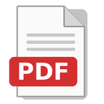

# PdfPaper

**PdfPaper** è un editor PDF portabile per Windows: si avvia senza installazione e funziona
interamente sul computer, senza connessione a internet.

*PdfPaper is a portable PDF editor for Windows (no installation, fully offline): OCR, text editing,
image insertion, page management, compression and true redaction. User interface in Italian.*

Creato da Giovanni CICCARESE.

## Funzioni

- **OCR**: rende ricercabili i PDF scansionati (italiano, inglese e altre lingue aggiungibili)
- **Testo**: aggiunta di testo nuovo e modifica del testo esistente, con carattere, dimensione e colore
  uguali a quelli del documento (letti dal PDF o stimati dalla scansione)
- **Immagini**: inserimento di immagini in un'area o come nuova pagina
- **Pagine**: inserimento (vuote, da altro PDF, da immagine), eliminazione, rotazione, spostamento
- **Compressione**: quattro livelli, da "solo ottimizzazione" a "forte"
- **Omissis**: redazione reale, il contenuto sotto l'area viene eliminato dal file
- **Selezione del testo** sulla pagina, con copia, taglia, incolla (anche immagini dagli appunti)
- **Menu del tasto destro** con le operazioni più comuni
- **Rotazione** delle pagine di 90° a destra, 90° a sinistra o 180° con un clic
- **Estrazione testo** in .txt, annulla fino a 20 passaggi

La guida completa con illustrazioni è in [docs/Guida_PdfPaper.pdf](docs/Guida_PdfPaper.pdf).

## Download e uso

**Microsoft Store** (consigliato): installazione firmata da Microsoft e aggiornamenti automatici.
*(Il link verrà aggiunto dopo la pubblicazione.)*

**Versione portabile**, senza installazione:

1. Scarica `PdfPaper-vX.Y.Z-win64.zip` dalla pagina [Releases](../../releases).
2. Estrai lo zip e avvia `PdfPaper\PdfPaper.exe`.

La versione portabile non è firmata digitalmente: al primo avvio Windows può mostrare un avviso
("Ulteriori informazioni" > "Esegui comunque").

Requisiti: Windows 10 o 11 a 64 bit. Non serve installare Python né altro.

**Disinstallazione**: la versione dello Store si rimuove da Impostazioni > App. La versione portabile
non modifica il sistema e non scrive nel registro: basta eliminare la cartella `PdfPaper`.

## Compilare dal codice sorgente

Su Windows con Python 3.10 o successivo: doppio clic su `build.bat`.
Il risultato è la cartella `dist\PdfPaper` (eseguibile, librerie in `lib\`, dati OCR in `tessdata\`).

Le release ufficiali sono compilate da GitHub Actions ([.github/workflows/build.yml](.github/workflows/build.yml))
direttamente da questo repository.

## Privacy policy

This program will not transfer any information to other networked systems unless specifically
requested by the user or the person installing or operating it.

PdfPaper non trasmette alcun dato in rete: i documenti vengono elaborati solo sul computer
dell'utente. I componenti di terze parti inclusi (vedi sotto) non effettuano connessioni di rete.

## Licenza

PdfPaper è software libero distribuito con licenza
[GNU Affero General Public License v3.0](LICENSE).

Componenti di terze parti e relative licenze: [THIRD_PARTY_NOTICES.md](THIRD_PARTY_NOTICES.md).
